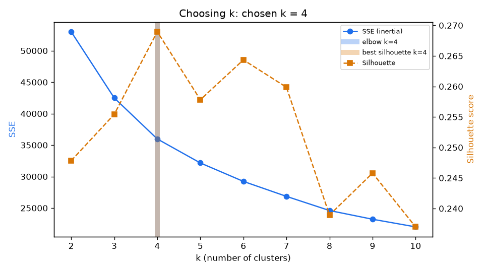

# IE 7374 MLOps: Airflow Lab 1 (Customer Segmentation)

My version of [Airflow Lab 1](https://github.com/raminmohammadi/MLOps/tree/main/Labs/Airflow_Labs/Lab_1)
from the course MLOps repo. The repo holds two DAGs, both running on **Apache Airflow 3.4** in Docker:

| DAG | File | What it is |
|---|---|---|
| `Airflow_Lab1` | [dags/airflow_lab1.py](dags/airflow_lab1.py) | **Baseline**: a faithful redo of the original lab (K-Means + elbow on the credit-card dataset). |
| `Customer_Segmentation_Pipeline` | [dags/customer_segmentation_dag.py](dags/customer_segmentation_dag.py) | **My extension**: a reworked pipeline with validation, better preprocessing, k selection, a quality gate, named segments and a run report. |

The dataset is the credit-card customer data that ships with the lab (`dags/data/file.csv`, 8,950 customers).

---

## Project layout

```
.
├── docker-compose.yaml            # official Airflow 3.4 compose + lab edits (see below)
├── dags/
│   ├── airflow_lab1.py            # baseline DAG (upstream lab)
│   ├── customer_segmentation_dag.py   # my DAG
│   ├── data/
│   │   ├── file.csv               # training data (from the lab)
│   │   ├── test.csv               # baseline's single test row (from the lab)
│   │   └── new_customers.csv      # my 5 hand-made customer personas to score
│   └── src/
│       ├── lab.py                 # baseline ML functions (upstream)
│       └── segmentation.py        # my ML functions (pure Python, unit-tested)
├── tests/test_segmentation.py     # pytest suite for segmentation.py
├── requirements-dev.txt           # local test deps
└── working_data/                  # (generated) run artifacts, mounted into containers
```

## Running it

Prerequisites: Docker Desktop with at least 4 GB of memory available to Docker (8 GB recommended).

```bash
# 1. Airflow user id (on Windows use 50000; on macOS/Linux use: echo "AIRFLOW_UID=$(id -u)" > .env)
echo "AIRFLOW_UID=50000" > .env

# 2. Initialize the metadata DB and create the admin user
docker compose up airflow-init

# 3. Start everything
docker compose up -d
```

Open <http://localhost:8080> and log in as **airflow2 / airflow2**. Both DAGs start paused: unpause one, then trigger it.

To trigger my DAG with custom parameters, use **Trigger → Advanced options** in the UI, or the CLI:

```bash
docker compose exec airflow-scheduler airflow dags trigger Customer_Segmentation_Pipeline --conf '{"min_silhouette": 0.5}'
```

Stop with `docker compose down` (add `-v` to also wipe the database).

### Edits made to the official `docker-compose.yaml` (as the lab instructs)

- `AIRFLOW__CORE__LOAD_EXAMPLES: 'false'`: hides Airflow's example DAGs
- `_PIP_ADDITIONAL_REQUIREMENTS: scikit-learn kneed matplotlib`: the ML dependencies
- `./working_data:/opt/airflow/working_data` volume: lets you open the pipeline outputs from the host
- Admin login changed to `airflow2 / airflow2`

---

## Part 1: Baseline (`Airflow_Lab1`)

Same four tasks as the upstream lab, using classic `PythonOperator`s:

```
load_data_task → data_preprocessing_task → build_save_model_task → load_model_task
```

The only changes are renaming `airflow.py` to `airflow_lab1.py` (a file named `airflow.py` shadows the
`airflow` package when you run it directly) and setting the DAG owner.

**Result:** the log prints `Optimal no. of clusters: 8`, and the task returns cluster `5`.

While redoing it I noticed two problems in the original:
1. It saves the **k=49** model from the last loop iteration, not the model at the elbow k.
2. The model is trained on **MinMax-scaled** data, but `test.csv` is passed to `predict()` **unscaled**,
   because the scaler is never saved.

So the returned cluster isn't meaningful. Fixing this was the starting point for my version.

---

## Part 2: My extension (`Customer_Segmentation_Pipeline`)

```
make_run_dir → validate_data → preprocess → choose_k → train_model ─┬→ evaluate → quality_gate ─┬→ promote_model ─┐
                                                                    │                           └→ flag_for_review ┤
                                                                    └→ profile_segments → score_new_customers ─────┴→ write_report → list_artifacts
```

### What changed vs. the baseline

| Area | Baseline | My version |
|---|---|---|
| DAG style | Classic `PythonOperator` + `op_args` | **TaskFlow API** (`@dag`, `@task`, `@task.branch`) |
| Scheduling | Manual only | **Weekly** (`0 6 * * 1`, Mondays 06:00 UTC), plus manual runs |
| Configuration | Hard-coded | **Runtime `Params`**: features, `k_min`, `k_max`, `k_method`, `min_silhouette` |
| XCom payloads | Base64-pickled DataFrames | Small JSON (file paths + metrics); artifacts written to disk |
| Data checks | None | **`validate_data`**: required columns, row count, null %, numeric types, no negative dollar values |
| Features | 3 (`BALANCE`, `PURCHASES`, `CREDIT_LIMIT`) | 8 (adds cash advance, payments, min payments, purchase frequency, full-payment rate) |
| Missing values | `dropna()` | Median imputation (keeps all 8,950 rows) |
| Scaling | MinMax | `log1p` on skewed dollar columns, then `StandardScaler` |
| Choosing k | Elbow on k=1..49, but saves k=49 | Elbow **or** silhouette over `k_min..k_max`; **saves the model at the chosen k** + a diagnostic plot |
| Saved model | Bare KMeans | One sklearn **`Pipeline`** (preprocessor + KMeans), so raw rows can be scored correctly |
| Evaluation | None | Silhouette, Davies-Bouldin, Calinski-Harabasz, cluster sizes |
| Deployment | None | **Quality-gate branch**: promote to `production/` with a `model_card.json`, or flag for review |
| Output | One integer | **Named segments**, scored new customers, Markdown `report.md`, plus a `BashOperator` listing artifacts |
| Testing | None | 9 pytest unit tests on the ML module |

### Results (default params)

The elbow and the best silhouette both pick **k = 4**. Silhouette = **0.268**, which clears the 0.20 gate, so the model is promoted.



| Cluster | Segment (auto-named) | Customers | Avg balance | Avg purchases | Avg cash advance | Full-pay rate |
|---|---|---:|---:|---:|---:|---:|
| 0 | Low Balance | 2,352 | $286 | $452 | $74 | 0.07 |
| 1 | High Purchase Frequency + High Balance | 2,896 | $2,733 | $1,838 | $1,303 | 0.03 |
| 2 | High Full-Payment Rate + High Purchase Frequency | 1,376 | $180 | $1,848 | $63 | 0.77 |
| 3 | Low Purchase Frequency + High Cash Advance | 2,326 | $2,221 | $22 | $2,032 | 0.03 |

Segments are named automatically: each cluster's mean is compared with the overall mean, and the
name uses the two features that stand out most (|z| ≥ 0.5).

**Scoring my 5 hand-made customers** ([new_customers.csv](dags/data/new_customers.csv)):

| Customer | Persona | Assigned segment |
|---|---|---|
| NEW001 | Revolver carrying a balance | Low Purchase Frequency + High Cash Advance |
| NEW002 | Big spender who pays in full | High Full-Payment Rate + High Purchase Frequency |
| NEW003 | Dormant card | Low Balance |
| NEW004 | Frequent small purchases | High Purchase Frequency + High Balance |
| NEW005 | Cash-advance heavy | Low Purchase Frequency + High Cash Advance |

### Trying the quality gate

Trigger with `{"min_silhouette": 0.5}`: `promote_model` is **skipped**, `flag_for_review` runs, and
the production model stays as it was. With the default 0.20, the opposite happens. `write_report` uses
the `none_failed_min_one_success` trigger rule, so it runs after either branch.

### Artifacts per run

`working_data/segmentation/runs/<run_id>/`:

`validation.json`, `preprocessor.pkl`, `X.npy`, `k_selection.png`, `segmentation_model.pkl`, `labels.npy`,
`metrics.json`, `segment_profile.csv`, `new_customer_predictions.csv`, `report.md`

The promoted model goes to `working_data/segmentation/production/` (`segmentation_model.pkl` + `model_card.json`).

---

## Running the unit tests locally

The ML logic in `dags/src/segmentation.py` doesn't import Airflow, so it can be tested without Docker:

```bash
python -m venv .venv
.venv/Scripts/pip install -r requirements-dev.txt   # macOS/Linux: .venv/bin/pip
.venv/Scripts/python -m pytest tests -q
```

## Something I learned

In Airflow 3, a `@task.branch` task **doesn't push its return value to XCom**; it only stores an
internal `skipmixin_key`. My first version passed the branch result into `write_report`, so the report
always said "flagged" even when the model was promoted. The fix is to check whether `promote_model`
pushed a result (a skipped task pushes nothing).
